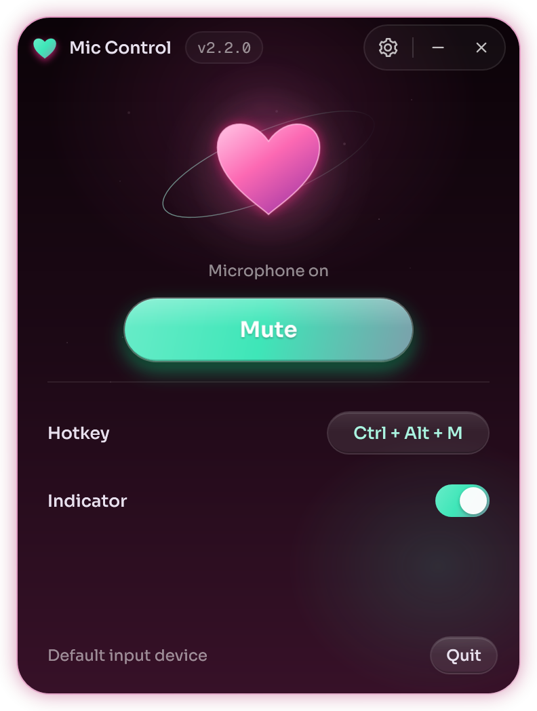
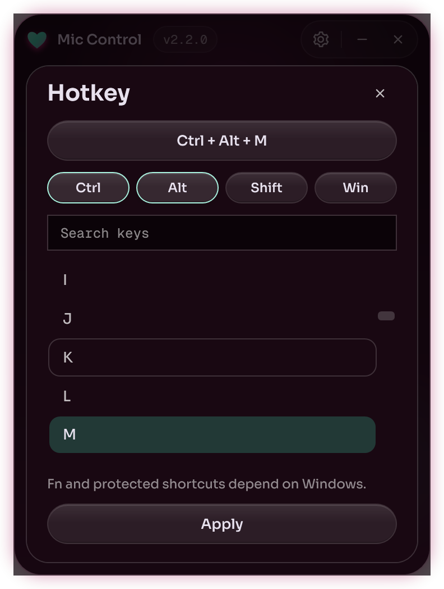
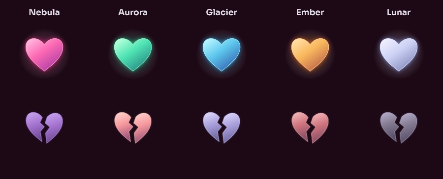

<div align="center">


# Mic Control: a tiny Windows microphone mute toggle with a global hotkey

**One shortcut mutes and unmutes the default microphone from anywhere. A heart in the corner of the screen shows the state: whole and glowing when the mic is on, broken when it is muted. Lives in the tray, one portable exe of about 100 KB, no installer, updates itself.**

[](https://github.com/softoblivion/cute-mic-control/releases/latest/download/MicControl.exe)
[](https://github.com/softoblivion/cute-mic-control/releases/latest)


[](LICENSE)






<sub>Press the shortcut · the heart breaks when the mic is muted · press again to unmute.</sub>

</div>

---

## Contents

- [Why Mic Control](#why-mic-control)
- [Quick start](#quick-start)
- [Features](#features)
- [Usage](#usage)
- [Settings](#settings)
- [Data and privacy](#data-and-privacy)
- [Updates](#updates)
- [Building from source](#building-from-source)
- [Project structure](#project-structure)
- [License](#license)

## Why Mic Control

- **One key, every app.** Mutes the Windows default input device itself, so calls, recorders and games all hear
  the same state, without looking for each app's own mute button.
- **You always know.** The heart overlay sits above ordinary windows and lets clicks pass through; the tray icon
  shows the same state.
- **Tiny and portable.** One exe of about 100 KB using the .NET Framework that ships with Windows. No installer, no
  admin rights, no background services. Settings stay in a folder next to the exe.
- **Free and open source.** GPL-3.0; build it yourself with the compiler that comes with Windows.

## Quick start

1. Download [`MicControl.exe`](https://github.com/softoblivion/cute-mic-control/releases/latest/download/MicControl.exe)
   and put it into a folder of its own, for example `D:\Apps\MicControl\`.
2. Run it. The settings window opens and the heart appears in the top-left corner.
3. Press **Ctrl + Alt + M** to mute or unmute. Close the window; the app keeps running in the tray.

**Requirements:** Windows 10 or 11 (.NET Framework 4.8 is preinstalled). No installer, no admin rights.

> [!NOTE]
> The executable is not code-signed, so Windows SmartScreen may warn on first start (**More info → Run anyway**).

## Features

| | |
|---|---|
| **Global hotkey** | Any key or combination: letters, F1–F24, NumPad and Num Enter, media keys, OEM keys, single modifiers (left or right), Ctrl / Alt / Shift / Win combinations. Record it or pick it from a searchable list. Holding the key does not toggle repeatedly. |
| **Heart indicator** | Whole heart with a double pulse = on, broken heart = muted, dim = no input device. Above ordinary windows, click-through, 50–200 % size. |
| **Five palettes** | Nebula, Aurora, Glacier, Ember, Lunar; each a pair of on / off colours for the overlay, the preview and the tray icon. |
| **Four themes** | Dusk, Nova, Frost, Bloom: the background colour and accent of the settings window, shared with the other softoblivion desktop apps. |
| **Tray app** | Toggle, Settings, update items and Quit in the tray menu; double-click opens Settings. Optional launch at login. |
| **Follows Windows** | Reads the mute state every 500 ms, so a mute from the Windows sound settings or a headset button shows up too; follows default-device changes. |
| **Self-update** | Checks GitHub Releases on start, downloads a new version in the background, verifies size and SHA-256, installs on one click. |
| **Self-test** | `--self-test` checks the hotkey engine, settings, the live window, the keyboard hook and the microphone toggle. |

## Usage

| Action | How |
|---|---|
| Mute / unmute | the hotkey (default **Ctrl + Alt + M**), **Mute** in Settings, or **Toggle microphone** in the tray menu |
| Change the hotkey | Settings → click the shortcut → record or pick a key → **Apply** |
| Open Settings | double-click the tray heart, or tray menu → **Settings** |
| Install an update | **Install** or **Restart to update** in the update window that opens when a new version is found (tray menu → **Restart to update** reopens it), or click the "Mic Control X.Y.Z is ready" notification |
| Quit | tray menu → **Quit** (the microphone keeps its current state) |

Fn keys, some vendor buttons and protected shortcuts such as Ctrl+Alt+Delete may not reach the app. The full guide:
[docs/USER_GUIDE.md](docs/USER_GUIDE.md).

## Settings

Stored in `cute-mic-control_data\settings.xml` next to the exe and saved as soon as they change.

| Key | Default | Meaning |
|---|---|---|
| `modifiers`, `key` | Ctrl + Alt, M | The hotkey (modifier bits Alt 1, Ctrl 2, Shift 4, Win 8; Windows virtual-key code) |
| `overlay` | `True` | Show the heart indicator |
| `indicatorScale` | `100` | Indicator size in percent, 50–200 |
| `theme` | `bloom` | Window theme: `dusk`, `nova`, `frost` or `bloom` (an unknown name falls back to `bloom`) |
| `palette` | `0` | 0 Nebula, 1 Aurora, 2 Glacier, 3 Ember, 4 Lunar |
| `autoDownloadUpdates` | `True` | Download a new version in the background; installing is always a click on **Restart to update** |

**Launch at login** is not in the file: it is the value `MicControlGlow` under
`HKCU\Software\Microsoft\Windows\CurrentVersion\Run`.

## Data and privacy

All data lives in `cute-mic-control_data\` next to `MicControl.exe`; nothing else is written to the user profile:

| Path | Content |
|---|---|
| `settings.xml` | Settings above |
| `updates\` | Downloaded updates and `apply.log` |
| `self-test\` | Report and previews of `--self-test` |

The app does not record audio and does not log keystrokes: the keyboard hook only compares keys with the shortcut,
in memory. The only network traffic is the update check and download from GitHub. Moving the exe together with its
data folder moves the whole installation.

> [!TIP]
> Upgrading from 1.0.0: that version kept its settings in `%LOCALAPPDATA%\Mic Control`. The first start of 1.1.0
> or later copies them into `cute-mic-control_data\`, so the shortcut and appearance stay as they were.

## Updates

- Checked on every start, then every 5 minutes while the app runs (also while the window is hidden in the tray), and
  with **Check for updates** in the tray menu or in Settings. A failed check is retried after a growing wait, up to
  an hour; nothing is checked while Windows reports no network connection. A new version downloads in the background (switch **Download updates automatically**, on by default)
  into `cute-mic-control_data\updates\` and is verified by byte size and SHA-256 against the `SHA256SUMS` asset of
  the release.
- A new version opens the update window with the release notes, the size and the date: **Install** downloads it and
  restarts into it, **Later** closes the window for this run (the tray menu and Settings open it again).
- **Restart to update** (update window, or a click on the notification) closes the app; the downloaded exe
  waits for it to exit, replaces `MicControl.exe` (the previous file stays as `MicControl.exe.old` until the new
  one starts), and starts the new version in the tray. If anything fails, the current exe stays as it was.
- Version 1.0.0 cannot update itself: download the current `MicControl.exe` once by hand.
- Every release ships two assets: `MicControl.exe` and `SHA256SUMS`. Release notes live in
  [`docs/releases/`](docs/releases/).

## Building from source

Requirements: Windows 10 / 11 and Windows PowerShell 5.1. The build uses the C# compiler of the .NET Framework that
ships with Windows; there is nothing to install.

```powershell
git clone https://github.com/softoblivion/cute-mic-control.git
cd cute-mic-control
powershell -ExecutionPolicy Bypass -File build\build.ps1
```

The script runs the update tests and produces `release\MicControl.exe` with `release\SHA256SUMS`.

| Task | Command |
|---|---|
| Build and run the update tests | `powershell -ExecutionPolicy Bypass -File build\build.ps1` |
| Self-test of the app (quit the running app first) | `release\MicControl.exe --self-test`, report in `cute-mic-control_data\self-test\` |
| Use a scratch data folder | set `MIC_CONTROL_HOME` before starting the exe |

Architecture, self-update and build notes: [ARCHITECTURE](docs/ARCHITECTURE.md) ·
[SELF_UPDATE](docs/SELF_UPDATE.md) · [BUILD](docs/BUILD.md) · [USER_GUIDE](docs/USER_GUIDE.md)

## Project structure

```
cute-mic-control/
├── src/                 the app: entry point and settings, tray and settings window, themes, heart overlay and palettes,
│                        keyboard hook, Core Audio, self-update, self-test, version
├── tests/               update tests (console runner built by build.ps1)
├── build/               build.ps1
└── docs/                architecture, self-update, build notes, user guide, release notes, README images
```

## License

Released under the [GNU General Public License v3.0](LICENSE). Any distributed copy or derivative work must stay
open source under the same license and keep the copyright notices.
