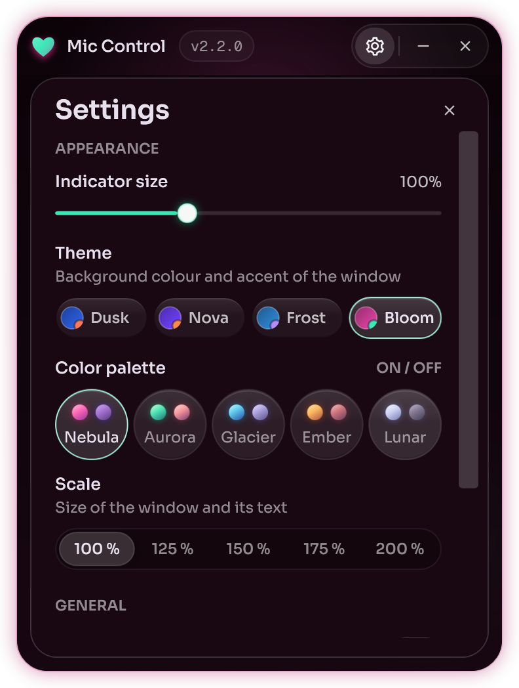

<div align="center">



[](https://github.com/softoblivion/cute-mic-control/releases/latest/download/MicControl.exe)
[](https://github.com/softoblivion/cute-mic-control/releases/latest)


[](LICENSE)

**A tiny Windows microphone mute toggle with a global hotkey: one shortcut mutes and unmutes the default microphone from anywhere. A heart in the corner of the screen shows the state: whole and glowing when the mic is on, broken when it is muted. Lives in the tray, one portable exe of about 330 KB, no installer, updates itself.**





<sub>Press the shortcut · the heart breaks when the mic is muted · press again to unmute.</sub>

</div>

---

## Why Mic Control

- **One key, every app.** Mutes the Windows default input device itself, so calls, recorders and games all hear
  the same state, without looking for each app's own mute button.
- **You always know.** The heart overlay sits above ordinary windows and lets clicks pass through; the tray icon
  shows the same state.
- **Tiny and portable.** One exe of about 330 KB using the .NET Framework that ships with Windows. No installer, no
  admin rights, no background services. Settings stay in a folder next to the exe.
- **Free and open source.** GPL-3.0; build it yourself with the compiler that comes with Windows.
- **Nothing else.** No audio is recorded and no keystrokes are logged; the only network traffic is the update check
  and download from GitHub.

## Quick start

1. Download [`MicControl.exe`](https://github.com/softoblivion/cute-mic-control/releases/latest/download/MicControl.exe)
   and put it into a folder of its own, for example `D:\Apps\MicControl\`.
2. Run it. The settings window opens and the heart appears in the top-left corner.
3. Press **Ctrl + Alt + M** to mute or unmute. Close the window; the app keeps running in the tray.

**Requirements:** Windows 10 or 11 (.NET Framework 4.8 is preinstalled). No installer, no admin rights.

> [!NOTE]
> The executable is not code-signed, so Windows SmartScreen may warn on first start (**More info → Run anyway**).

## Features

| | |
|---|---|
| **Global hotkey** | Any key or combination: letters, F1–F24, NumPad and Num Enter, media keys, OEM keys, single modifiers (left or right), Ctrl / Alt / Shift / Win combinations. Record it or pick it from a searchable list. Holding the key does not toggle repeatedly. |
| **Heart indicator** | Whole heart with a double pulse = on, broken heart = muted, dim = no input device. Above ordinary windows, click-through, 50–200 % size. |
| **Five palettes** | Nebula, Aurora, Glacier, Ember, Lunar; each a pair of on / off colours for the overlay, the preview and the tray icon. |
| **Four themes** | Dusk, Nova, Frost, Bloom: the background colour and accent of the settings window, shared with the other softoblivion desktop apps. |
| **Scale** | 100–200 % for the whole window and its text on top of the Windows display scaling; sharp at every step. |
| **Tray app** | Toggle, Settings, update items and Quit in the tray menu; double-click opens Settings. Optional launch at login. |
| **Follows Windows** | Reads the mute state every 500 ms, so a mute from the Windows sound settings or a headset button shows up too; follows default-device changes. |
| **Self-update** | Checks GitHub Releases on start, downloads a new version in the background, verifies size and SHA-256, installs on one click. |
| **Self-test** | `--self-test` checks the hotkey engine, settings, the live window, the keyboard hook and the microphone toggle. |

## Documentation

| Document | What it covers |
|---|---|
| [User guide](docs/USER_GUIDE.md) | Usage, hotkey, settings, microphone behaviour, data folder, updates, FAQ |
| [Architecture](docs/ARCHITECTURE.md) | Stack, layout, modules, runtime data, window themes |
| [Self-update](docs/SELF_UPDATE.md) | Update check, verified download, apply mode, failure handling, update window |
| [Build](docs/BUILD.md) | Toolchain, build, tests, environment variables, releasing |
| [Release notes](docs/releases/) | What changed in every version |
| [Third-party components](docs/THIRD_PARTY.md) | What the app uses from Windows, with licences |

## Building from source

Requirements: Windows 10 / 11 and Windows PowerShell 5.1. The build uses the C# compiler of the .NET Framework that
ships with Windows; there is nothing to install.

```powershell
git clone https://github.com/softoblivion/cute-mic-control.git
cd cute-mic-control
powershell -ExecutionPolicy Bypass -File build\build.ps1
```

The script runs the update tests and produces `release\MicControl.exe` with `release\SHA256SUMS`.

| Task | Command |
|---|---|
| Build and run the update tests | `powershell -ExecutionPolicy Bypass -File build\build.ps1` |
| Self-test of the app (quit the running app first) | `release\MicControl.exe --self-test`, report in `cute-mic-control_data\self-test\` |
| Use a scratch data folder | set `MIC_CONTROL_HOME` before starting the exe |

## License

Released under the [GNU General Public License v3.0](LICENSE). Any distributed copy or derivative work must stay
open source under the same license and keep the copyright notices.
